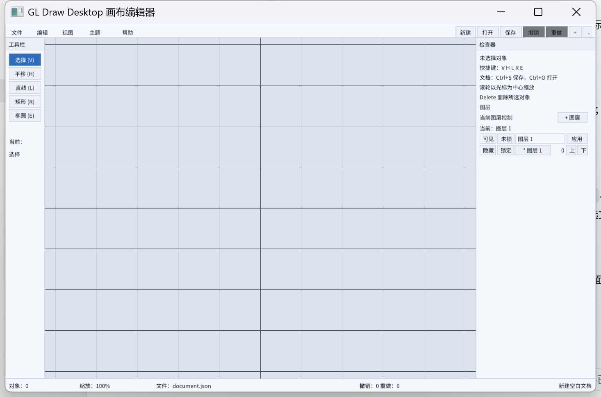

# GL Draw Desktop

基于 OpenGL 3.3 与 Nuklear 即时模式 GUI 的画布绘图编辑器。仓库名与远程地址为
`gl-draw-desktop`，构建产物与安装目录使用 `gldrawdesktop` 命名空间。

本项目只提供中文文档与中文界面，不再维护英文版本。



## 快速开始

首次检出先运行 bootstrap，它会检查工具链并完成一次 configure：

**Windows PowerShell**

```powershell
./scripts/bootstrap.ps1
```

**Linux/macOS**

```sh
./scripts/bootstrap.sh
```

日常检查与构建：

```powershell
./scripts/check.ps1
```

```sh
./scripts/check.sh
```

手动执行 CMake 命令：

```sh
cmake --preset ninja-debug
cmake --build --preset ninja-debug
ctest --preset ninja-debug --output-on-failure
```

运行应用：

```sh
./build/ninja-debug/bin/gl-draw-desktop
```

命令行参数：

```text
-h, --help     显示帮助
-v, --version  显示版本号
```

## 环境要求

- CMake 3.21 或更高版本。
- Ninja（默认 preset）与 C11 编译器（MSVC、GCC、Clang、AppleClang）。
- 支持 OpenGL 3.3 的显卡驱动。
- 首次配置需要网络：GLFW 3.3.9 通过 FetchContent 获取；离线环境可用
  `FETCHCONTENT_SOURCE_DIR_GLFW` 指向本地 GLFW 源码。

Linux 还需要 OpenGL 与 X11 开发包，macOS 需要 Xcode Command Line Tools。
详见 [环境配置](docs/guides/environment.md)。

## 项目结构

```text
include/                    公共头文件（app、document、commands、tools、ui 等）
src/                        实现；模块与 include/ 保持同名目录
third_party/                vendored GLAD、KHR、Nuklear（不参与项目警告）
tests/                      CTest 测试（Unity）
cmake/                      CMake 模块
scripts/                    本地引导、检查与质量门禁脚本
docs/                       中文项目文档
assets/                     截图与界面字体
shaders/                    OpenGL 着色器
themes/                     内置与外部主题
packaging/                  Windows 安装包与 Linux desktop 文件
tools/                      发布打包脚本
```

## 界面字体

界面使用随包分发的 Noto Sans SC Regular（SIL OFL 1.1），按 GB2312 常用字
范围烘焙图集。构建时字体复制到可执行文件同级的 `fonts/` 目录，安装后位于
`share/gldrawdesktop/fonts/`；可用 `GLDRAWDESKTOP_FONT` 环境变量指定其他
字体文件。字体来源与再生成方式见
[assets/fonts/README.md](assets/fonts/README.md)。

## 安装

```sh
cmake --preset ninja-release
cmake --build --preset ninja-release
cmake --install build/ninja-release --prefix install
```

安装内容包括可执行文件、着色器、主题、脚本、界面字体与文档。本项目是纯应用，
不导出库或 CMake 包。

## 文档

- [CMake 与构建](docs/guides/cmake.md)
- [操作与快捷键](docs/guides/controls.md)
- [测试与质量门禁](docs/guides/testing.md)
- [编码规范](docs/guides/coding-style.md)
- [环境配置](docs/guides/environment.md)
- [依赖与 third_party](docs/guides/dependencies.md)
- [发布流程](docs/guides/release.md)
- [AI 代理政策](docs/guides/ai-agents.md)
- [AI 代理工作流](docs/guides/agent-playbooks.md)
- [架构决策记录索引](docs/adr/README.md)
- [ADR 0001 Workspace 作为编辑器枢纽](docs/adr/0001-workspace-as-editor-hub.md)
- [ADR 0002 持久变更通过 CommandExecutor](docs/adr/0002-command-executor-for-durable-mutations.md)
- [ADR 0003 描述符驱动的对象与工具](docs/adr/0003-descriptor-driven-objects-and-tools.md)
- [ADR 0004 UI 不拥有编辑规则](docs/adr/0004-ui-does-not-own-editing-rules.md)
- [ADR 0005 AI 代理贡献边界](docs/adr/0005-ai-agent-contribution-boundaries.md)
- [ADR 0006 第三方源码布局](docs/adr/0006-third-party-source-layout.md)
- [ADR 0007 应用型项目与中文单语适配](docs/adr/0007-application-and-chinese-only-shape.md)
- [归档文档索引](docs/archive/README.md)
- [历史重构记录](docs/archive/REFACTOR_LOG.md)
- [工程标准](C_PROJECT_STANDARD.md)
- [贡献指南](CONTRIBUTING.md)
- [安全策略](SECURITY.md)

## 许可证

MIT，见 [LICENSE](LICENSE)。界面字体另受 SIL Open Font License 1.1 约束。
